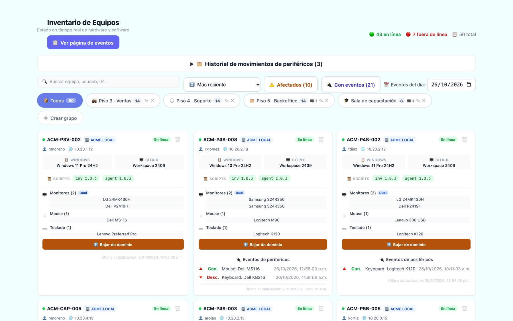
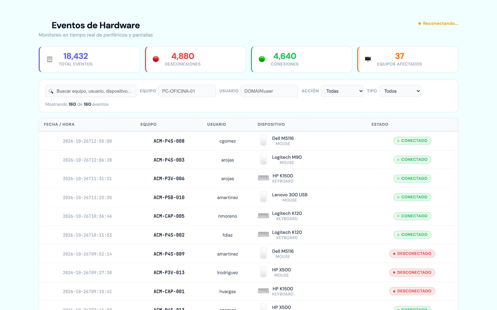
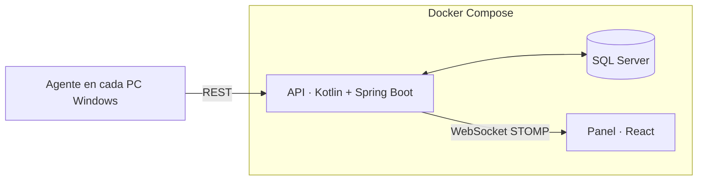

# 🛡️ HardGuard — Inventario y monitoreo de periféricos en tiempo real

**Qué se conecta, qué se desconecta y a qué equipo se movió, al instante**

[🌐 Ver portafolio](https://azixtechnologyco-rgb.github.io/#hardguard)

## El problema

Un centro de contacto con cientos de puestos perdía mouses, teclados y monitores sin saber cuándo
ni dónde, y el inventario de hardware se hacía a mano.

## La solución

Un **agente liviano** en cada equipo Windows reporta su hardware y cada evento de periféricos a una API
central. El panel muestra todo en tiempo real.

- **Inventario vivo de cada equipo:** monitores, mouse, teclado, Windows, Citrix, CPU, RAM, disco y versión del agente.
- **Eventos al instante** por WebSocket: conexiones y desconexiones en unos 3 segundos.
- **Detección de traslados:** si un periférico sale de un equipo y aparece en otro, queda registrado.
- Grupos por piso o área, con el número de pantallas esperado, y filtros de equipos afectados.
- Operaciones remotas de dominio y control de versiones del agente.
- En producción sobre **755 equipos** y más de **18 000 eventos** registrados.

## Capturas

## Arquitectura

**Stack:** Kotlin 2 · Spring Boot 4 · Hibernate · SQL Server · WebSocket STOMP · PowerShell · React 18 · Vite · Docker Compose · Nginx

---

> 🔒 El código fuente es privado. Las capturas usan **datos de ejemplo** (empresa ficticia «ACME»):
> ningún equipo, usuario ni dirección real.
>
> Desarrollado por **[Azix Technology](https://azixtechnologyco-rgb.github.io)** · Isaac Ávila
